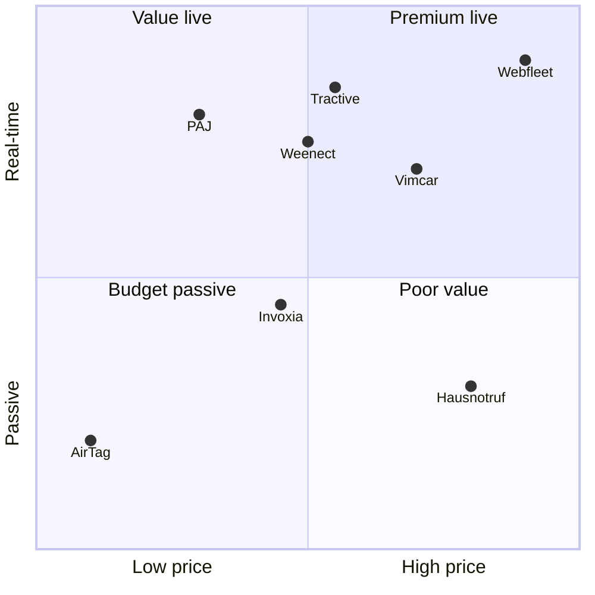
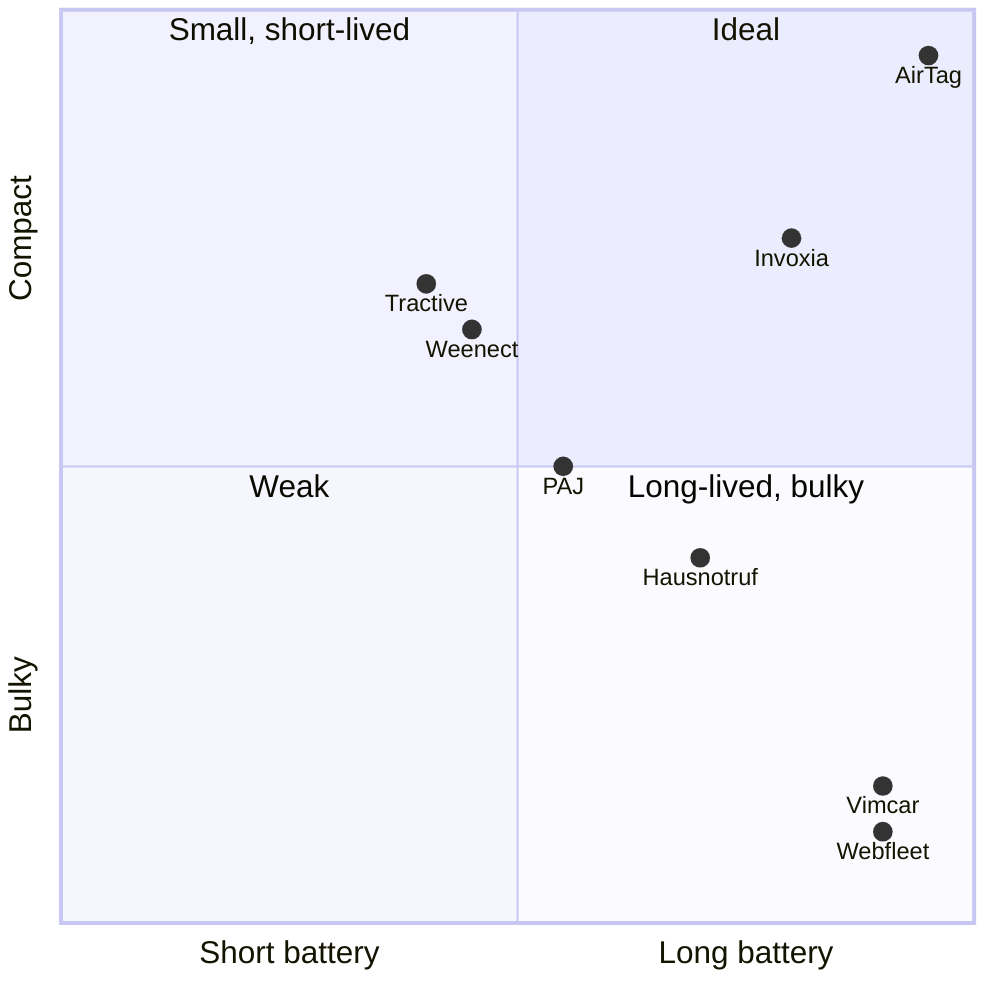
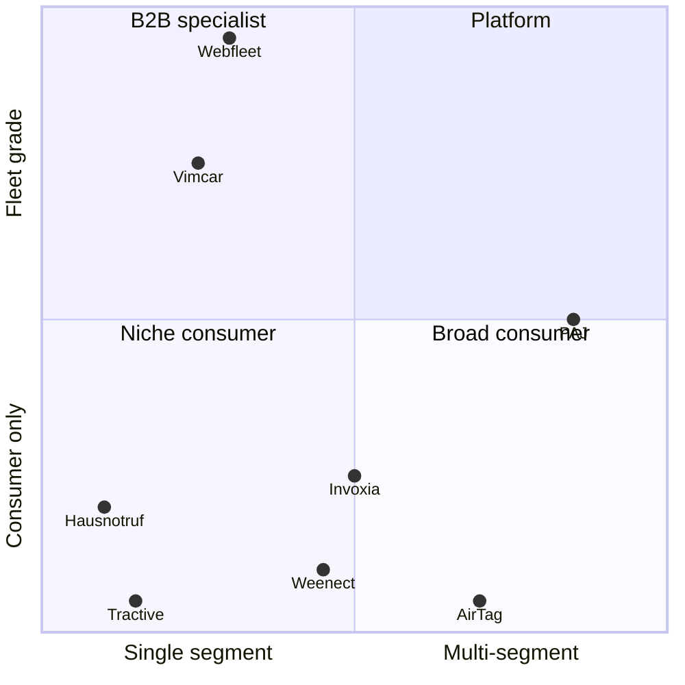
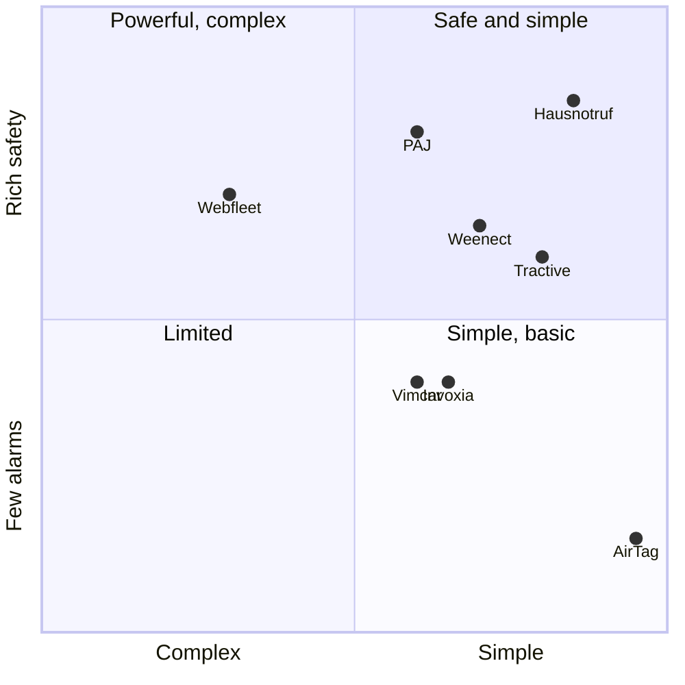

# Positioning

_Updated: 2026-10-20 · Scores 0–1, directional estimates (verify)._

## Executive summary
- **Where PAJ sits:** affordable, real-time 4G tracking across pets, people and vehicles, all in one app.
- **Open space:** low price with real-time tracking. Only AirTag is cheaper, and it is not real-time.
- **Threats:** Tractive owns pet brand, Webfleet/Samsara own fleet depth, AirTag owns "no subscription."
- **Play:** own "one app, every tracker, honest price". Use breadth to grow devices per customer (goal 2).

**Method:** 8 buying variables, paired into 4 maps. Same 8 players on each. Score each 0–1, look for open quadrants.

| Map | X | Y |
|---|---|---|
| 1 | Price (TCO) | Real-time tracking |
| 2 | Battery life | Portability (size/weight) |
| 3 | Portfolio breadth | Business/fleet depth |
| 4 | Ease of use | Safety features (SOS, alarms, geofence) |

---

### Map 1 — Price vs real-time tracking

→ PAJ leads "value live."

### Map 2 — Battery life vs portability

→ PAJ is mid-pack. Battery/size gap vs AirTag and Invoxia.

### Map 3 — Portfolio breadth vs business depth

→ PAJ alone near "platform." Moat for cross-sell.

### Map 4 — Ease of use vs safety features

→ Rich safety features. Simplicity is the gap vs Hausnotruf/Tractive.

---

## Claims and proof
| Claim | Proof | Strength |
|---|---|---|
| Real-time 4G tracking, anywhere | Cellular + GPS, FINDER app/portal | strong |
| One app for pets, people, vehicles | FINDER portal, full device range | strong |
| Affordable | Subscriptions from ~€5–7/mo (verify) · cheaper than Tractive per techtest.org | medium |
| Made for Europe, GDPR | German company, Windeck, since 2011 | medium |
| Safety alarms | SOS, geofence, speed, vibration alarms | strong |
| Long battery | Up to ~5 days (PET Finder, manufacturer data) | thin |
